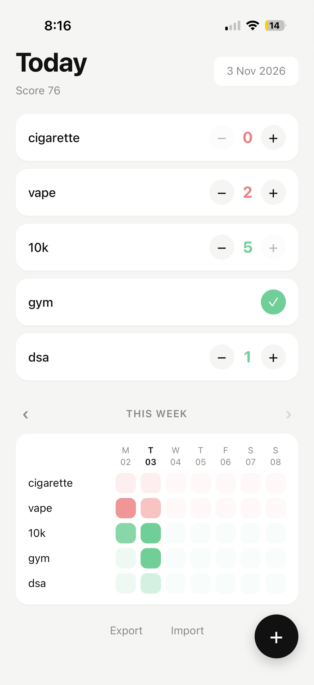

# Tudum

A small daily habit tracker for my iPhone. I wanted something minimal that does just what I need, without accounts, ads or a subscription, so I made it myself.

**Live:** https://saksham1525.github.io/tudum/



## What it does

- Add habits as **Good** (do more) or **Bad** (do less), tracked as **Yes / No** or a **Scale** from 0 to 5
- Tick today's habits and see a daily score out of 100
- Browse past weeks (Monday to Sunday) and add or fix entries for any earlier day
- Reorder habits
- Export and import all data as a JSON file
- Works offline

## Install on iPhone

Open the link in Safari, tap Share, then **Add to Home Screen**.

## Your data

Everything is stored on your device in the browser's `localStorage`. There is no server or account, and nothing leaves your phone. The flip side is that deleting the Home Screen app or clearing Safari's website data erases it, so use **Export** now and then to keep a backup.

## Run locally

```bash
python3 -m http.server
```

Then open http://localhost:8000.

## Built with

Plain HTML, CSS and JavaScript, plus a service worker and web manifest for the installable app. Hosted on GitHub Pages.
